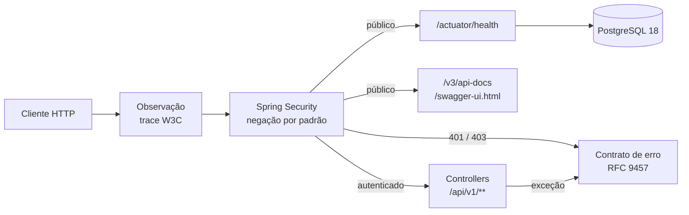

# Nexa Finance API

[](https://github.com/maykontardoche/nexa-finance-api/actions/workflows/ci.yml)

API REST de controle financeiro pessoal em Java 25, Spring Boot 4.1 e PostgreSQL 18.

**Aviso:** este é um projeto de portfólio e acadêmico (FIAP). Não é um produto financeiro real:
não movimenta dinheiro e não deve receber dados pessoais reais.

## Sobre o projeto

O objetivo é um backend de finanças pessoais: usuários, contas, receitas, despesas,
transferências e resumo financeiro. O projeto começou como uma entrega acadêmica (uma CLI sobre
JDBC e Oracle) e foi refeito do zero como uma API, com as práticas esperadas de um serviço em
produção.

| Camada | Tecnologia |
|---|---|
| Linguagem | Java 25 LTS |
| Framework | Spring Boot 4.1 (Spring MVC, Spring Security, Actuator) |
| Banco de dados | PostgreSQL 18, Spring Data JPA (Hibernate) e migrations Flyway |
| Documentação da API | OpenAPI 3.1 e Swagger UI (springdoc) |
| Observabilidade | Micrometer Tracing com OpenTelemetry (W3C `traceparent`) e logs JSON no contêiner |
| Testes | JUnit Jupiter, AssertJ, Spring Boot Test e Testcontainers |
| Build e entrega | Maven Wrapper, Docker, Docker Compose e GitHub Actions |

## Estado atual

A base da API está pronta. Ainda não há endpoints de negócio: cadastro, login, contas e
lançamentos entram nas próximas fases (veja o [roadmap](#roadmap)). Hoje a API já:

- sobe junto com o banco com um único comando, sem precisar instalar Java;
- expõe um health check público que reflete a conexão com o banco;
- publica a documentação navegável no Swagger UI;
- responde todo erro no formato RFC 9457 (`application/problem+json`), em português;
- exige autenticação em tudo que não está na lista pública, inclusive em rotas que não existem;
- passa por CI com testes, teste de fumaça do contêiner e varreduras de segredos e de
  dependências.

## Como a API funciona

Todo erro segue um único contrato, definido no
[ADR-0004](docs/adr/0004-erros-rfc-9457-com-type-urn.md). O corpo traz um `type` estável
(`urn:nexa-finance:problem:<slug>`), o `title` e o `detail` em português, o `instance` e o
`traceId`. Em erro de validação, o campo `errors` lista todos os campos inválidos de uma vez. O
corpo nunca expõe stack trace, SQL ou nome de classe: esses detalhes ficam só no log do servidor.

A segurança é fechada por padrão, conforme o
[ADR-0005](docs/adr/0005-negacao-por-padrao-antes-do-roteamento.md). Sem credencial, qualquer rota
fora da lista pública responde `401`, mesmo que ela não exista. Assim, quem não está autenticado
não consegue descobrir quais rotas existem. Um teste quebra o build se alguém liberar uma rota fora
dessa lista.

Cada requisição recebe um trace W3C. O `traceId` volta no corpo dos erros e aparece nas linhas de
log da requisição. Se o cliente envia um `traceparent`, ele é respeitado. Se faltar `DB_URL`,
`DB_USERNAME` ou `DB_PASSWORD`, a aplicação não sobe e informa qual variável falta, sem mostrar
nenhum valor.

No contêiner, o processo roda sem root, com sistema de arquivos somente leitura, sem capabilities
do Linux, com limite de memória e com healthcheck. As decisões de stack e de contrato estão
registradas em [ADRs](docs/adr/README.md).

## Arquitetura

É um monólito modular. Cada módulo de domínio entra em uma fase, com as camadas `api`,
`application`, `domain` e `infrastructure`. Os primeiros são `auth` e `user` (identidade), hoje só
com as entidades e o schema; os endpoints entram nas próximas versões.

O diagrama abaixo mostra o caminho de uma requisição:

1. o filtro de observação cria o trace ou continua o que o cliente enviou;
2. a cadeia de segurança decide o acesso:
   - o health (que consulta o PostgreSQL) e a documentação são públicos;
   - o restante exige autenticação e chega aos controllers sob `/api/v1`;
3. qualquer erro, da segurança ou do controller, é convertido no formato RFC 9457 por um único
   componente.



Mais detalhes em [`docs/arquitetura/`](docs/arquitetura/README.md).

## Como rodar

### Pré-requisitos

- **Para rodar com Docker:** [Docker](https://docs.docker.com/get-docker/) com Compose v2 (no
  Windows e no macOS, o Docker Desktop).
- **Para desenvolver:** o mesmo Docker e um JDK 25 (por exemplo, o
  [Eclipse Temurin](https://adoptium.net/)). Não é preciso instalar Maven: o wrapper do repositório
  baixa a versão certa e confere o checksum.

### Com Docker (aplicação e banco em contêiner)

Linux, macOS ou Git Bash:

```bash
git clone https://github.com/maykontardoche/nexa-finance-api.git
cd nexa-finance-api
cp .env.example .env
docker compose --profile app up -d --build --wait
```

PowerShell:

```powershell
git clone https://github.com/maykontardoche/nexa-finance-api.git
cd nexa-finance-api
Copy-Item .env.example .env
docker compose --profile app up -d --build --wait
```

O `--wait` só termina quando a aplicação e o banco estão saudáveis. Depois disso:

- health: <http://localhost:8080/actuator/health> responde `{"status":"UP"}`;
- Swagger UI: <http://localhost:8080/swagger-ui.html>.

Para conferir health, segurança e documentação de uma vez, rode o teste de fumaça. Ele precisa de
bash, que vem com o Git Bash no Windows:

```bash
scripts/smoke-test.sh
```

Para parar, use `docker compose --profile app down`. Para também apagar os dados do banco,
acrescente `-v`.

### Com o JDK (desenvolvimento)

Linux, macOS ou Git Bash:

```bash
git clone https://github.com/maykontardoche/nexa-finance-api.git
cd nexa-finance-api
cp .env.example .env
docker compose up -d db
./mvnw spring-boot:run -Dspring-boot.run.profiles=local
```

PowerShell (as aspas no `-D` são necessárias; sem elas, o PowerShell quebra o argumento no ponto):

```powershell
git clone https://github.com/maykontardoche/nexa-finance-api.git
cd nexa-finance-api
Copy-Item .env.example .env
docker compose up -d db
.\mvnw.cmd spring-boot:run "-Dspring-boot.run.profiles=local"
```

No perfil `local`, a aplicação lê o mesmo `.env` do Compose e escreve os logs em texto legível. O
health e o Swagger ficam nos mesmos endereços.

## Variáveis de ambiente

As variáveis ficam no `.env`, que nunca é versionado. O [`.env.example`](.env.example) traz valores
fictícios e um comentário para cada variável.

| Variável | Obrigatória | Exemplo | Uso |
|---|---|---|---|
| `DB_URL` | Sim | `jdbc:postgresql://localhost:5432/nexa` | URL JDBC do banco ao rodar com o JDK. No Compose, a aplicação usa o serviço `db` |
| `DB_USERNAME` | Sim | `nexa` | Usuário do banco, criado pelo Compose |
| `DB_PASSWORD` | Sim | `troque-me` | Senha do banco. Troque por uma sua |
| `DB_NAME` | Sim, no Compose | `nexa` | Nome do banco criado pelo serviço `db` |
| `SERVER_PORT` | Não | `8080` | Porta HTTP. No Compose, é a porta publicada no host |

Se faltar uma variável obrigatória, a aplicação não sobe e mostra, por exemplo:

```text
Variável de ambiente obrigatória ausente ou vazia: DB_URL.
```

## Usando a API

| Método | Rota | Acesso | Resposta |
|---|---|---|---|
| `GET` | `/actuator/health` | Público | `200 {"status":"UP"}` ou `503 {"status":"DOWN"}` |
| `GET` | `/v3/api-docs` | Público | Documento OpenAPI 3.1 |
| `GET` | `/swagger-ui.html` | Público | Swagger UI |
| Qualquer | Qualquer outra rota | Autenticado | Sem credencial, `401`. Os endpoints de negócio entram na Fase 2 |

As convenções, o catálogo de erros e os endpoints estão em
[`docs/arquitetura/api-contract.md`](docs/arquitetura/api-contract.md).

Exemplo de erro:

```bash
curl -i http://localhost:8080/api/v1/contas
```

```http
HTTP/1.1 401
Content-Type: application/problem+json
```

```json
{
  "type": "urn:nexa-finance:problem:unauthorized",
  "title": "Não autenticado",
  "status": 401,
  "detail": "É preciso se autenticar para acessar este recurso.",
  "instance": "/api/v1/contas",
  "traceId": "4bf92f3577b34da6a3ce929d0e0e4736"
}
```

O cliente deve decidir pelo `type`, nunca pelo texto. Os tipos existentes são `bad-request`,
`validation-error`, `unauthorized`, `forbidden`, `not-found`, `method-not-allowed`,
`unsupported-media-type` e `internal-error`. Ao reportar um problema, informe o `traceId`: ele
localiza a requisição nos logs.

## Testes

```bash
./mvnw -B verify
```

No PowerShell, use `.\mvnw.cmd -B verify`. O comando compila, roda a suíte completa e gera o jar.
Os testes de integração sobem um PostgreSQL 18 real com Testcontainers, então o Docker precisa
estar ligado. Nenhum teste usa credencial real nem serviço externo.

A suíte cobre:

- a inicialização, o Flyway e a recusa de subir sem configuração obrigatória;
- o contrato de erro para 400, validação, 401, 403, 404, 405, 415 e 500, inclusive erros que
  acontecem fora do MVC;
- a negação por padrão, a lista exata de rotas públicas e uma guarda contra liberações
  indevidas;
- o `traceId` propagado do `traceparent` até o corpo e o log;
- a ausência de credenciais nos logs;
- o health `UP` e `DOWN` (com o banco realmente parado) e o documento OpenAPI 3.1.

## Integração contínua

Todo pull request para o `main` passa pelo [workflow de CI](.github/workflows/ci.yml), e o merge
só é liberado com os checks verdes:

| Job | O que verifica |
|---|---|
| `build` | Compilação, testes e links da documentação |
| `container` | Imagem construída, aplicação e banco saudáveis no Compose e teste de fumaça |
| `secrets` | [gitleaks](https://github.com/gitleaks/gitleaks) no histórico inteiro, com [regras próprias](.gitleaks.toml) para credenciais em `.properties`, `.yml` e `.env` |
| `dependency-review` | Dependência nova com vulnerabilidade conhecida de severidade moderada ou maior |

As actions são fixadas por SHA e as imagens base do `Dockerfile`, por digest. O Dependabot propõe
atualizações toda semana, e o `main` é protegido contra force-push.

## Estrutura do repositório

```text
.
├── src/main/java/br/com/fintech/
│   ├── NexaFinanceApplication.java   # inicialização
│   ├── auth/, user/                  # módulos de identidade (entidades e repositórios JPA)
│   ├── config/                       # segurança, /api/v1, OpenAPI, locale, Tomcat, configuração obrigatória
│   └── shared/web/                   # contrato de erro (RFC 9457) e respostas 401/403
├── src/main/resources/               # application*.yml, mensagens em português, db/migration (Flyway)
├── src/test/java/                    # testes de unidade e de integração (Testcontainers)
├── docs/                             # ADRs, arquitetura, contrato da API e runbooks
├── scripts/                          # teste de fumaça e verificação de links
├── Dockerfile                        # build em estágios, runtime sem root
└── compose.yaml                      # PostgreSQL e aplicação (profile app)
```

## Documentação

| Documento | Conteúdo |
|---|---|
| [`docs/arquitetura/`](docs/arquitetura/README.md) | Arquitetura e componentes |
| [`docs/arquitetura/api-contract.md`](docs/arquitetura/api-contract.md) | Convenções, catálogo de erros e endpoints |
| [`docs/adr/`](docs/adr/README.md) | Decisões de arquitetura (ADR-0001 a ADR-0009) |
| [`docs/runbooks/`](docs/runbooks/README.md) | Procedimentos operacionais |

## Roadmap

| Fase | Entrega | Situação |
|---|---|---|
| Base | Build, ambiente, contrato de erro, segurança, health, OpenAPI, contêiner e CI | Concluída |
| Identidade | Cadastro, login com token e perfil | Planejada |
| Contas e lançamentos | Contas, receitas, despesas, histórico e resumo | Planejada |
| Transferências | Transferência entre contas com consistência | Planejada |
| Interface web | Telas sobre a API, rodando localmente no mesmo Compose | Planejada |

Ainda não existem cadastro e login, regras financeiras, CORS para frontend, rate limiting nem deploy
em ambiente público. Cada item entra na fase correspondente.
