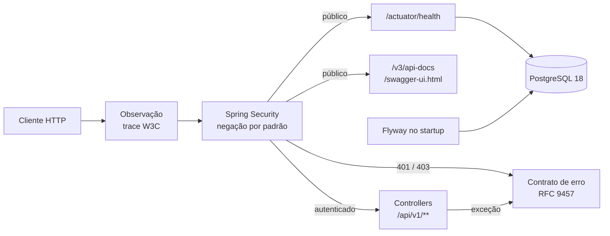

<div align="center">

# Nexa Finance API

**API REST de controle financeiro pessoal, construída com padrões de produção.**

[](https://github.com/maykontardoche/nexa-finance-api/actions/workflows/ci.yml)


</div>

> [!IMPORTANT]
> Projeto de **portfólio e acadêmico** (FIAP). **Não é um produto financeiro real**: não
> movimenta dinheiro, não guarda dados reais e não deve ser usado com informações pessoais.

---

## Sumário

- [Visão geral](#visão-geral)
- [Estágio do projeto](#estágio-do-projeto)
- [Destaques de engenharia](#destaques-de-engenharia)
- [Arquitetura](#arquitetura)
- [Começando](#começando)
  - [Pré-requisitos](#pré-requisitos)
  - [Caminho 1 — só Docker](#caminho-1--só-docker-recomendado-para-avaliar)
  - [Caminho 2 — desenvolvimento com JDK](#caminho-2--desenvolvimento-com-jdk)
- [Variáveis de ambiente](#variáveis-de-ambiente)
- [Usando a API](#usando-a-api)
- [Testes e qualidade](#testes-e-qualidade)
- [CI e segurança da cadeia de suprimentos](#ci-e-segurança-da-cadeia-de-suprimentos)
- [Estrutura do repositório](#estrutura-do-repositório)
- [Documentação](#documentação)
- [Roadmap](#roadmap)
- [Fora de escopo](#fora-de-escopo)

---

## Visão geral

A **Nexa Finance API** (nome provisório) é o backend de um sistema de finanças pessoais:
usuários, contas, receitas, despesas, transferências e resumo financeiro. O projeto nasceu como
entrega acadêmica (uma CLI sobre JDBC e Oracle) e foi refeito do zero como uma API com as
práticas que se espera de um serviço em produção: contrato de erro padronizado, segurança
fechada por padrão, rastreabilidade de ponta a ponta, contêiner endurecido e CI como porta de
entrada do código.

| Camada | Tecnologia |
|---|---|
| Linguagem | Java 25 LTS |
| Framework | Spring Boot 4.1 (Spring MVC, Spring Security, Actuator) |
| Banco de dados | PostgreSQL 18 com migrations Flyway |
| Documentação da API | OpenAPI 3.1 e Swagger UI (springdoc) |
| Observabilidade | Micrometer Tracing + OpenTelemetry (W3C `traceparent`), logs JSON (ECS) |
| Testes | JUnit 5, AssertJ, Spring Boot Test, Testcontainers |
| Build e entrega | Maven Wrapper, Docker multi-stage, Docker Compose, GitHub Actions |

## Estágio do projeto

**Fundação concluída (MVP Fases 0 e 1).** A base que todas as funcionalidades vão herdar está
pronta e testada. Os endpoints de negócio (cadastro, login, contas, lançamentos) chegam nas
próximas fases; veja o [roadmap](#roadmap).

O que já funciona hoje:

- Aplicação e banco sobem com **um comando**, sem instalar Java.
- Health check público que reflete o banco (`UP`/`DOWN`).
- Documentação navegável da API (Swagger UI).
- Todo erro no formato **RFC 9457** (`application/problem+json`), em pt-BR.
- Tudo fora da lista pública exige autenticação, inclusive rotas que não existem.
- CI com testes, teste de fumaça do contêiner, varredura de segredos e de vulnerabilidades.

## Destaques de engenharia

- **Contrato de erro único** ([ADR-0004](docs/adr/0004-erros-rfc-9457-com-type-urn.md)):
  todo erro sai como RFC 9457, com `type` estável (`urn:nexa-finance:problem:<slug>`),
  `title` e `detail` em pt-BR, `instance` e `traceId`. Erros de validação listam **todos** os
  campos inválidos em `errors[]`. Nenhuma resposta expõe stack trace, SQL ou nome de classe.
- **Negação por padrão** ([ADR-0005](docs/adr/0005-negacao-por-padrao-antes-do-roteamento.md)):
  sem credencial, qualquer rota fora da lista pública responde `401`, inclusive a inexistente.
  Assim ninguém descobre quais rotas existem. Um teste falha o build se alguém liberar uma rota
  fora da lista.
- **Rastreabilidade:** cada requisição recebe um trace W3C. O `traceId` volta no corpo do erro e
  aparece em todas as linhas de log daquela requisição. Se o cliente enviar `traceparent`, ele é
  respeitado.
- **Falha cedo e com clareza:** sem `DB_URL`, `DB_USERNAME` ou `DB_PASSWORD`, a aplicação não
  sobe e diz qual variável falta, sem nunca ecoar valores.
- **Contêiner endurecido:** imagem fixada por digest, processo sem root (UID 10001), sistema de
  arquivos somente leitura, nenhuma capability do Linux, limite de memória e healthcheck.
- **Testes que provam algo:** cada regra crítica foi validada por **mutação manual**: o código
  foi quebrado de propósito para confirmar que o teste correspondente falha.
- **Decisões registradas:** as escolhas de stack e de contrato estão em
  [ADRs](docs/adr/README.md), com contexto, alternativas e consequências.

## Arquitetura

Monólito modular: hoje existe a infraestrutura transversal, e os módulos de domínio entram fase
a fase, cada um com as camadas `api`, `application`, `domain` e `infrastructure`.

Descrição do diagrama abaixo: o cliente HTTP passa primeiro pelo filtro de observação (que cria
ou continua o trace) e depois pela cadeia de segurança. Rotas públicas seguem para o health
(que consulta o PostgreSQL) e para a documentação OpenAPI. As demais exigem autenticação e
chegam aos controllers sob `/api/v1`. Qualquer erro, da segurança ou do controller, é convertido
no formato RFC 9457 por um único componente. O Flyway aplica as migrations no startup.



Mais detalhes em [`docs/arquitetura/`](docs/arquitetura/README.md).

## Começando

### Pré-requisitos

| Caminho | O que instalar |
|---|---|
| 1 — só Docker | [Docker](https://docs.docker.com/get-docker/) com Compose v2 (Docker Desktop no Windows e no macOS) |
| 2 — desenvolvimento | O mesmo Docker **e** um JDK 25 (ex.: [Eclipse Temurin](https://adoptium.net/)). **Não** é preciso instalar Maven: o wrapper do repositório baixa a versão certa e confere o checksum |

Os comandos abaixo usam a sintaxe de shell POSIX (Linux, macOS, Git Bash). No PowerShell, troque
`cp` por `Copy-Item` e `./mvnw` por `.\mvnw.cmd`.

> [!TIP]
> **Windows:** se o `git clone` falhar com `Filename too long`, habilite caminhos longos no Git
> (`git config --global core.longpaths true`) ou clone numa pasta de caminho curto (ex.:
> `C:\projetos`). O limite padrão do Windows é de 260 caracteres por caminho.

### Caminho 1 — só Docker (recomendado para avaliar)

```bash
git clone https://github.com/maykontardoche/nexa-finance-api.git
cd nexa-finance-api
cp .env.example .env
docker compose --profile app up -d --build --wait
```

O `--wait` só termina quando a aplicação e o banco estão saudáveis. Depois disso:

- Health: <http://localhost:8080/actuator/health> → `{"status":"UP"}`
- Swagger UI: <http://localhost:8080/swagger-ui.html>

Para conferir tudo de uma vez (health, segurança e documentação), rode o teste de fumaça:

```bash
scripts/smoke-test.sh
```

Para parar (o `-v` também apaga os dados do banco):

```bash
docker compose --profile app down
```

### Caminho 2 — desenvolvimento com JDK

```bash
git clone https://github.com/maykontardoche/nexa-finance-api.git
cd nexa-finance-api
cp .env.example .env
docker compose up -d db
./mvnw spring-boot:run -Dspring-boot.run.profiles=local
```

No perfil `local`, a aplicação lê o mesmo `.env` do Compose e escreve logs em texto legível.
Health e Swagger ficam nos mesmos endereços do caminho 1.

## Variáveis de ambiente

Todas ficam no `.env` (nunca versionado). O [`.env.example`](.env.example) traz valores
fictícios e um comentário por variável.

| Variável | Obrigatória | Exemplo | Para que serve |
|---|---|---|---|
| `DB_URL` | Sim | `jdbc:postgresql://localhost:5432/nexa` | URL JDBC do banco no caminho 2. No Compose, a aplicação usa o serviço `db` automaticamente |
| `DB_USERNAME` | Sim | `nexa` | Usuário do banco; o Compose cria esse usuário |
| `DB_PASSWORD` | Sim | `troque-me` | Senha do banco. Troque por uma sua |
| `DB_NAME` | Sim (Compose) | `nexa` | Nome do banco criado pelo serviço `db` |
| `SERVER_PORT` | Não | `8080` | Porta HTTP (no Compose, a porta publicada no host) |

Se faltar uma variável obrigatória, a aplicação não sobe e mostra:

```text
Variável de ambiente obrigatória ausente ou vazia: DB_URL.
```

## Usando a API

### Endpoints disponíveis

| Método | Rota | Acesso | Resposta |
|---|---|---|---|
| `GET` | `/actuator/health` | Público | `200 {"status":"UP"}` ou `503 {"status":"DOWN"}` |
| `GET` | `/v3/api-docs` | Público | Documento OpenAPI 3.1 |
| `GET` | `/swagger-ui.html` | Público | Swagger UI |
| qualquer | qualquer outra rota | Autenticado | Sem credencial: `401` (os endpoints de negócio chegam na Fase 2) |

O registro completo, com convenções e catálogo de erros, está em
[`docs/arquitetura/api-contract.md`](docs/arquitetura/api-contract.md).

### Formato de erro

```bash
curl -i http://localhost:8080/api/v1/contas
```

```http
HTTP/1.1 401
Content-Type: application/problem+json
```

```json
{
  "type": "urn:nexa-finance:problem:unauthorized",
  "title": "Não autenticado",
  "status": 401,
  "detail": "É preciso se autenticar para acessar este recurso.",
  "instance": "/api/v1/contas",
  "traceId": "4bf92f3577b34da6a3ce929d0e0e4736"
}
```

O cliente decide pelo `type`, nunca pelo texto. Os tipos disponíveis são `bad-request`,
`validation-error`, `unauthorized`, `forbidden`, `not-found`, `method-not-allowed`,
`unsupported-media-type` e `internal-error`. Informe o `traceId` ao reportar um problema: ele
localiza a requisição nos logs.

## Testes e qualidade

```bash
./mvnw -B verify
```

Compila, roda a suíte completa e gera o jar. Os testes de integração sobem um PostgreSQL 18 real
com **Testcontainers**, então o Docker precisa estar ligado. Nenhum teste usa credencial real nem
serviço externo.

O que a suíte cobre:

- inicialização, Flyway e recusa de startup sem configuração (em subprocesso, com ambiente
  controlado);
- o contrato de erro para 400, validação, 401, 403, 404, 405, 415 e 500, inclusive erros fora do
  MVC;
- negação por padrão, lista exata de rotas públicas e guarda estrutural contra liberações
  indevidas;
- `traceId` propagado do `traceparent` até o corpo e o log;
- ausência de credenciais nos logs (header `Authorization` e senha do banco);
- health `UP` e `DOWN` (com o banco realmente parado) e documento OpenAPI 3.1.

## CI e segurança da cadeia de suprimentos

Todo pull request para o `main` passa pelo [workflow de CI](.github/workflows/ci.yml), e o merge
só é liberado com os checks verdes:

| Job | O que garante |
|---|---|
| `build` | Compilação e suíte completa de testes |
| `container` | Imagem construída, aplicação e banco saudáveis no Compose e teste de fumaça |
| `secrets` | [gitleaks](https://github.com/gitleaks/gitleaks) no histórico inteiro, com [regras próprias](.gitleaks.toml) para credencial em `.properties`, `.yml` e `.env` |
| `dependency-review` | Nenhuma dependência nova com vulnerabilidade conhecida, sobre o grafo Maven resolvido |

Além disso: actions fixadas por SHA, imagens Docker fixadas por digest, Dependabot semanal,
secret scanning e push protection do GitHub ativos, e o `main` protegido contra force-push.

## Estrutura do repositório

```text
.
├── src/main/java/br/com/fintech/
│   ├── NexaFinanceApplication.java   # bootstrap
│   ├── config/                       # segurança, /api/v1, OpenAPI, locale, Tomcat, configuração obrigatória
│   └── shared/web/                   # contrato de erro (RFC 9457) e handlers 401/403
├── src/main/resources/               # application*.yml, mensagens pt-BR, db/migration (Flyway)
├── src/test/java/                    # testes de unidade e de integração (Testcontainers)
├── docs/                             # ADRs, arquitetura, contrato da API e runbooks
├── scripts/smoke-test.sh             # teste de fumaça da API no ar
├── Dockerfile                        # build multi-stage, runtime sem root
└── compose.yaml                      # PostgreSQL + aplicação (profile app)
```

## Documentação

| Documento | Conteúdo |
|---|---|
| [`docs/arquitetura/`](docs/arquitetura/README.md) | Arquitetura e componentes |
| [`docs/arquitetura/api-contract.md`](docs/arquitetura/api-contract.md) | Convenções, catálogo de erros e endpoints |
| [`docs/adr/`](docs/adr/README.md) | Decisões de arquitetura (ADR-0001 a ADR-0005) |
| [`docs/runbooks/`](docs/runbooks/README.md) | Procedimentos operacionais (ex.: segredo vazado) |

## Roadmap

| Fase | Entrega | Situação |
|---|---|---|
| 0 e 1 — Fundação | Build, ambiente, contrato de erro, segurança, health, OpenAPI, contêiner e CI | ✅ Concluída |
| 2 — Identidade | Cadastro, login com token e perfil | Planejada |
| 3 — Contas e lançamentos | Contas, receitas, despesas, histórico e resumo | Planejada |
| 4 — Transferências | Transferência entre contas com consistência | Planejada |
| 5 — Portfólio | Dados de demonstração, exemplos e diagramas | Planejada |
| — Interface visual | Telas web sobre a API, rodando local no mesmo Compose | Planejada (após a Fase 3) |

## Fora de escopo

Nesta fase **não** existem: cadastro e login, regras financeiras, CORS para frontend, rate
limiting, deploy em ambiente público nem migração de dados do sistema antigo. Cada item tem sua
fase no [roadmap](#roadmap).

---

<div align="center">

Feito por **Maykon Tardoche** · projeto de portfólio e acadêmico (FIAP)

</div>
