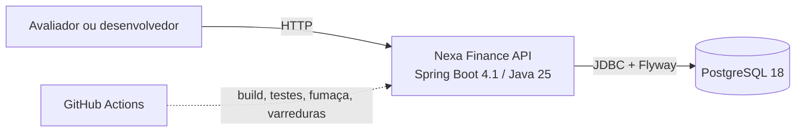
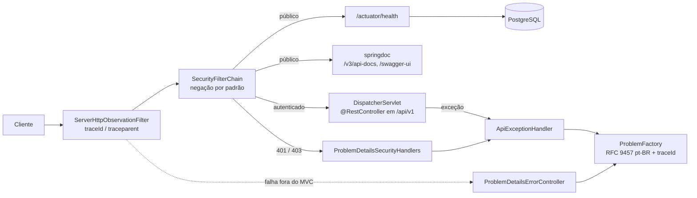

# Arquitetura

> As decisões que justificam esta arquitetura estão em [`../adr/`](../adr/README.md).

## Visão geral

A Nexa Finance API é um **monólito modular** Spring Boot 4.1 sobre Java 25, com PostgreSQL 18 como
banco único. Ela roda localmente: no host, com o JDK, ou inteira em contêiner pelo Docker Compose.
Não há deploy público nem integração externa em tempo de execução. Os usuários são avaliadores e
desenvolvedores que chamam a API diretamente ou pelo Swagger UI.

Descrição do diagrama de contexto: o cliente HTTP (navegador no Swagger UI, `curl` ou, no futuro,
a interface visual) chama a API. A API usa só o PostgreSQL. No desenvolvimento e na CI, o
GitHub Actions constrói, testa e verifica o código, e o Testcontainers sobe um PostgreSQL
descartável para os testes.

## Fluxo de uma requisição

Descrição: toda requisição passa primeiro pelo filtro de observação, que cria ou continua o trace
W3C. Em seguida passa pela cadeia do Spring Security. As rotas públicas (health e documentação)
seguem direto. As demais exigem autenticação e, sem credencial, recebem 401 antes do roteamento
(ADR-0005). Requisições autenticadas chegam aos controllers sob `/api/v1`. Qualquer erro, seja da
segurança, do controller ou de um filtro, sai no formato RFC 9457 montado por um único
componente (ADR-0004).

## Componentes

| Componente | Responsabilidade | Onde vive |
|---|---|---|
| `NexaFinanceApplication` | Bootstrap; exclui o usuário em memória do Spring Security | `br.com.fintech` |
| `RequiredConfiguration` + `MissingConfigurationFailureAnalyzer` | Recusa o startup sem `DB_URL`/`DB_USERNAME`/`DB_PASSWORD`, nomeando só a variável | `br.com.fintech.config` |
| `ApiVersioningConfig` | Prefixo `/api/v1` em todo `@RestController` do projeto | `br.com.fintech.config` |
| `SecurityConfig` | Lista pública explícita (`PUBLIC_PATHS`), resto autenticado, stateless, method security | `br.com.fintech.config` |
| `LocaleConfig` | Locale fixo pt-BR para erros e Bean Validation | `br.com.fintech.config` |
| `OpenApiConfig` | Metadados do OpenAPI 3.1, schema `ProblemDetail` e 401/500 em toda operação | `br.com.fintech.config` |
| `WebServerConfig` | Tomcat repassa `%2F`/`%5C` ao firewall do Spring (erro no contrato, não em HTML) | `br.com.fintech.config` |
| `ProblemType` | Catálogo estável de `type` (`urn:nexa-finance:problem:<slug>`) | `br.com.fintech.shared.web` |
| `ProblemFactory` | Único ponto que monta o corpo de erro (`instance`, `traceId`, `errors[]`) | `br.com.fintech.shared.web` |
| `ApiExceptionHandler` | Converte erros do MVC e da segurança em RFC 9457; loga 5xx com stack só no servidor | `br.com.fintech.shared.web` |
| `ProblemDetailsSecurityHandlers` | 401/403 dos filtros, delegados ao `ApiExceptionHandler` | `br.com.fintech.shared.web` |
| `ProblemDetailsErrorController` | Erros fora do MVC (filtros, container), mesmo formato e headers de segurança | `br.com.fintech.shared.web` |
| Flyway | Migrations em `src/main/resources/db/migration`, aplicadas no startup | dependência |

## Convenções

- **Camadas e direção de dependência:** cada módulo de domínio (Fases 2–4) terá `api` →
  `application` → `domain` ← `infrastructure`. Os módulos dependem de `shared`, nunca o
  contrário; `domain` não conhece Spring Web nem JDBC.
- **Tratamento de erro:** só pelo `ProblemFactory`; slug novo entra no `ProblemType`, nas
  mensagens pt-BR e no [`api-contract.md`](api-contract.md) (ADR-0004).
- **Autorização:** sempre no servidor; rota pública só pela `PUBLIC_PATHS`, com teste (ADR-0005).
- **Logs e auditoria:** `traceId`/`spanId` em todo log de requisição; JSON (ECS) no contêiner;
  nunca senha, token, header `Authorization` ou corpo de requisição em log.

## Contrato de API

Registro de endpoints e convenções: [`api-contract.md`](api-contract.md). Documento gerado em
tempo de execução: `/v3/api-docs` (OpenAPI 3.1) e `/swagger-ui.html`.
